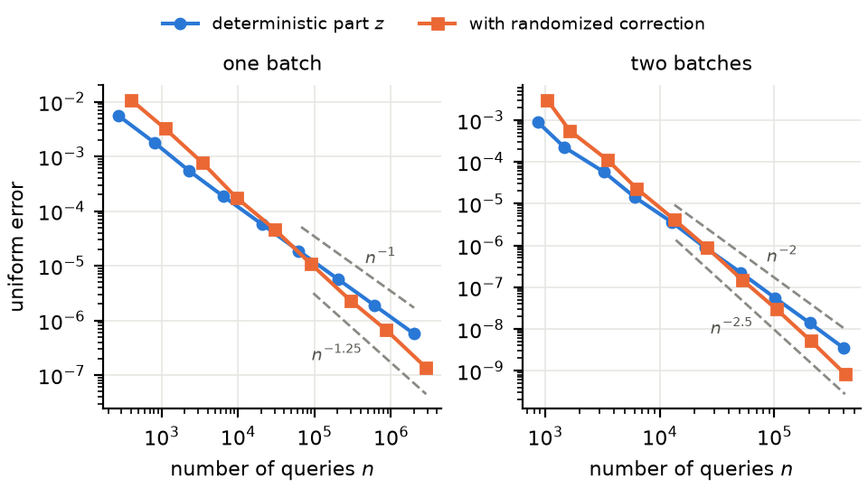

# Batched information for initial-value problems: numerical experiment

This repository contains the code and data for the numerical experiment (Section 7) of the paper

> Lihui Dong and Zhuo Li, *Randomized point-query complexity of initial-value problems with batched information*, submitted to *Journal of Complexity*.

The paper studies how the number of batches of parallel point evaluations of the right-hand side limits the error of an ODE solver. The experiment checks the predicted error exponents for one and two batches on a scalar equation.

## The test problem

We solve the scalar initial-value problem

    y'(t) = f(t, y(t)),   y(0) = 0,   0 <= t <= 1,

with the test field

    f(t, x) = 0.5 sin(2 pi t + 3x) + 0.4 cos(x - 3t).

This is the case d = 1 (one state variable) and s = 2 (Hoelder smoothness), so the fully adaptive randomized exponent is s + 1/2 = 5/2. The error is the maximum error along the trajectory, and for randomized algorithms we report its root-mean-square value over 50 independent runs.

## Predicted and measured exponents

The exponents are least-squares slopes of log(error) against log(n) over the four largest budgets, where n is the number of queries.

| Algorithm | Measured | Predicted | Source in the paper |
|---|---|---|---|
| One batch, deterministic path z | 1.006 | 1 | Theorem 3 |
| One batch, with randomized correction | 1.251 | 5/4 | Theorem 1 |
| Two batches, deterministic path z | 2.007 | 2 | Theorem 3 |
| Two batches, with randomized correction | 2.515 | 5/2 | Theorem 2 |



## Algorithms

**One batch.** The batch queries a lattice with spacing h = M^(-1/2) in t and x on [0,1] x [-1-2h, 1+2h]. Bilinear interpolation of these values gives a field F, and the path z solves z' = F(t, z). In the same batch, the algorithm draws random times and queries the vertical slices at these times with spacings h 2^(-j), j = 0, ..., J, where J is the first level with spacing at most M^(-5/8). The number of random times per level follows the multilevel allocation of Lemma 3. The correction is added along z through the first-variation formula, with P(t) = exp(int_0^t dF/dx(u, z(u)) du).

**Two batches.** The first batch queries the same lattice without random times and returns the path z1. The bilinear error bound and Gronwall's inequality give the certified radius R = 10.56 h^2 for the error of z1; the script checks this bound in every run. The second batch queries a lattice with spacing 1/M on the tube of radius R + 3/M about z1, and slices of radius R + 2/M about z1(u) at random times, with spacings down to M^(-5/4).

**Query count.** Every lattice node and every node of a random-time slice counts as one query, including slice nodes that the interpolation at z(u) does not use, because the slice is fixed before z is known.

**Time stepping and reference.** The paths z and P are computed with the classical fourth-order Runge-Kutta method on steps aligned with the lattice times (at least 2 x 10^4 steps for the first lattice and 64M steps for the second). The reference solution uses `scipy.integrate.solve_ivp` with the DOP853 method, rtol = 1e-13 and atol = 1e-15.

## Files

| File | Content |
|---|---|
| `ivp_batches.py` | Runs both experiments and writes the results to a JSON file |
| `plot_rates.py` | Draws the figure of the paper from the JSON file |
| `results.json` | Results used in the paper |
| `fig_rates.pdf`, `fig_rates.png` | Figure 2 of the paper (PDF) and a PNG copy for this page |
| `requirements.txt` | Python dependencies |

## Requirements

Python 3 with NumPy, SciPy and Matplotlib:

    pip install -r requirements.txt

The results in `results.json` were produced with Python 3.14.4, NumPy 2.5.3, SciPy 1.18.1 and Matplotlib 3.11.2.

## Reproducing the results

    python ivp_batches.py results.json
    python plot_rates.py results.json fig_rates.pdf
    python plot_rates.py results.json fig_rates.png

The first command runs one batch for M = 100, ..., 10^6 and two batches for M = 25, ..., 12800, with 50 runs per budget, and prints the results. The second command draws the two-panel figure.

All random numbers come from `numpy.random.default_rng` with fixed seeds: 1000 + i for the i-th budget of the one-batch experiment and 2000 + i for the two-batch experiment. A rerun with the same library versions reproduces `results.json`.

## Format of `results.json`

- `one`, `two`: one entry per budget M, with
  - `M`: budget parameter,
  - `n_det`, `err_det`: number of queries and uniform error of the deterministic path z,
  - `n`, `rms`: mean number of queries and root-mean-square uniform error with the randomized correction,
  - `levels`: number J of correction levels,
  - for two batches also `delta` (certified radius R after the first batch) and `batch1_err` (observed error of z1).
- `slopes`: fitted slopes `one_det`, `one_rand`, `two_det`, `two_rand` (negative exponents).

## Citation

If you use this code, please cite the paper:

```bibtex
@unpublished{DongLi2026batched,
  author = {Lihui Dong and Zhuo Li},
  title  = {Randomized point-query complexity of initial-value problems with batched information},
  note   = {Submitted to Journal of Complexity},
  year   = {2026}
}
```